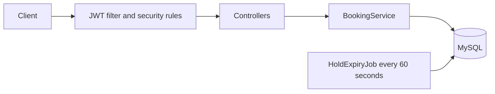

# Ticket Booking API

Backend for booking seats at events. The core problem it solves: when many users try to book the same seat at once, exactly one succeeds and everyone else gets a clean 409. Users log in with a JWT, and the server always takes the user from the token, never from the request.

**Stack:** Java 21, Spring Boot 4, Spring Data JPA (Hibernate), Spring Security with JWT, MySQL 8, JUnit 5, Mockito, springdoc (Swagger UI)

## Features

- Register and login with BCrypt-hashed passwords and JWT access tokens (roles: USER, ADMIN)
- Public browsing: list events and see each event's seats
- Only an ADMIN can create an event, which generates its seat grid
- Hold a seat for 5 minutes, confirm it into a booking, or cancel the booking
- Only the owner of a booking can cancel it
- `GET /api/bookings/me` lists the logged-in user's own bookings
- A scheduled job releases holds that were never confirmed
- Interactive API docs with Swagger UI and an Authorize button for the token

## How it works



1. **Hold:** a logged-in user holds a seat for 5 minutes (AVAILABLE to HELD).
2. **Confirm:** the same user confirms before the hold expires (HELD to BOOKED, a booking is created).
3. **Cancel:** the booking's owner cancels it and the seat becomes AVAILABLE again.
4. **Expiry:** every 60 seconds a job releases holds whose time has passed.

## The hard problem: double booking

The seat row is loaded with a pessimistic lock (`SELECT ... FOR UPDATE`) inside a transaction. Concurrent requests for the same seat wait for each other, then see the updated status and get a 409.

**Why pessimistic, not optimistic:** everyone wants the same hot seat at the same time, so conflicts are the normal case. Optimistic locking would make most requests fail and retry. `@Version` stays on the seat as a second layer in case a code path skips the lock.

**Cancel is locked too:** the booking row is locked before it is cancelled. Two overlapping cancels of the same booking cannot both free the seat, so a late cancel can never release a seat that someone else has booked in the meantime.

**Proof:** a test fires 100 simultaneous hold requests at one seat.

```
SUCCESS=1 CONFLICT=99 OTHER=0
```

## Authentication and authorization

Passwords are stored as BCrypt hashes. Login returns a signed JWT (60-minute lifetime) containing the user id, email and role. A filter validates the token on every request and the user id always comes from the token, so a `userId` sent in a request body is ignored.

| Endpoint | Who may call it |
| --- | --- |
| `POST /api/auth/register`, `POST /api/auth/login` | Anyone |
| `GET /api/events`, `GET /api/events/{id}/seats` | Anyone |
| `POST /api/events` | ADMIN only |
| `POST /api/seats/{id}/hold`, `POST /api/seats/{id}/confirm` | Any logged-in user, acting as themselves |
| `POST /api/bookings/{id}/cancel` | The booking's owner only |
| `GET /api/bookings/me` | Any logged-in user |

A missing or invalid token returns 401. A wrong role, or cancelling someone else's booking, returns 403. The ownership check runs before the "already cancelled" check, so a stranger learns nothing about another user's booking.

## API

| Method | Endpoint | Auth | Purpose |
| --- | --- | --- | --- |
| POST | /api/auth/register | public | Create a user, returns a JWT |
| POST | /api/auth/login | public | Returns a JWT |
| GET | /api/events | public | List events |
| GET | /api/events/{id}/seats | public | List seats and their status |
| POST | /api/events | admin | Create an event with a seat grid (up to 26 rows and 50 seats per row) |
| POST | /api/seats/{id}/hold | user | Hold a seat for 5 minutes |
| POST | /api/seats/{id}/confirm | user | Confirm a held seat into a booking |
| POST | /api/bookings/{id}/cancel | owner | Cancel a booking |
| GET | /api/bookings/me | user | My bookings, newest first |

Errors use one format: `{"status": 409, "error": "..."}`. Validation errors add a `fields` map.

Interactive docs: `http://localhost:8080/swagger-ui.html`

## Run it

Requirements: Java 21, MySQL 8, Maven (or the included `mvnw`).

1. Create the database: `CREATE DATABASE ticket_booking;`
2. Copy `src/main/resources/application.properties.example` to `application.properties` and set your MySQL password and a JWT secret of at least 32 characters.
3. Run `TicketBookingApplication`, then open the Swagger UI.
4. To try the admin endpoints, register a user, run `UPDATE users SET role = 'ADMIN' WHERE email = '...';` in MySQL, and log in again to get an admin token.

## Tests

| Test class | Type | What it covers |
| --- | --- | --- |
| `BookingServiceTest` | 11 unit tests (Mockito) | Hold, confirm and cancel rules, including owner-only cancel |
| `ConcurrentBookingTest` | 1 concurrency test, real MySQL | 100 simultaneous holds of one seat: 1 succeeds, 99 get 409 |
| `ApiSecurityTest` | 12 HTTP tests against the running app | 401 and 403 rules, admin-only event creation, owner-only cancel, `userId` in the body ignored, `bookings/me`, register and login |

Run them with `./mvnw test` (the database must be running).

## Design decisions and tradeoffs

- **Pessimistic locking instead of optimistic:** the same hot seat is contended by many users, so waiting on a row lock is simpler and more predictable than failing and retrying.
- **The token decides who is acting:** the user id is never accepted from the request body, so nobody can hold, confirm or cancel on behalf of someone else.
- **Holds expire by time, not by a flag:** a hold is valid only while `heldUntil` is in the future, and the cleanup job just tidies up what has already expired.
- **JWT keeps the server stateless:** the tradeoff is that a token cannot be revoked before it expires, and a role change needs a new login.
- **Public browsing:** events and seats can be viewed without logging in, like a normal ticket site.

## Limitations and next steps

- The schema is generated by Hibernate (`ddl-auto=update`); a production system should use a migration tool such as Flyway
- No refresh tokens, no rate limiting, and no real payment step
- A booking row is kept after cancellation, so "one active booking per seat" is enforced by seat status and locking, not by a table constraint